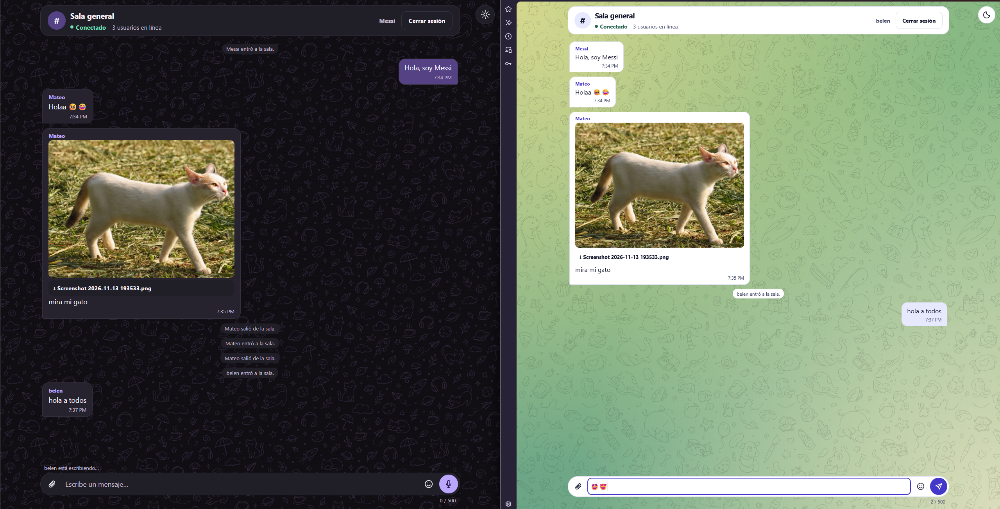
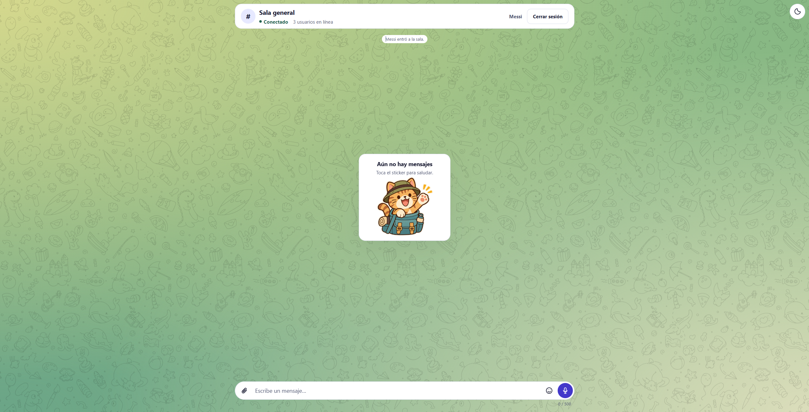
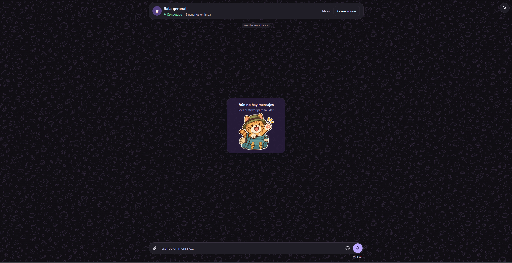
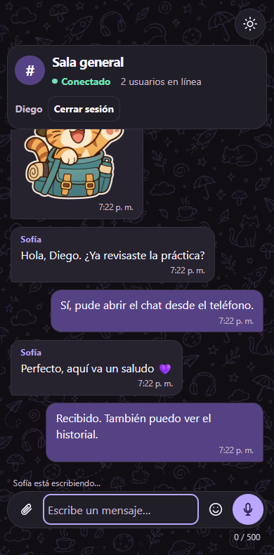

# Chat EPN

Chat web en tiempo real con una sala general para usuarios registrados.

## Características

- Registro con nombre visible, correo y contraseña, inicio de sesión y cierre de sesión con Firebase Authentication.
- Mensajes propios a la derecha y recibidos a la izquierda, con el nombre del remitente y la hora local. La cuenta se identifica por su UID aunque comparta nombre con otra.
- Avisos de entrada y salida, contador de usuarios conectados sin duplicar cuentas con varias pestañas e indicador de escritura.
- Estados de conexión visibles y reconexión automática con el borrador intacto.
- Historial de los últimos 50 mensajes en Firestore, sincronizado con los mensajes en vivo sin duplicados.
- Validación de 1 a 500 caracteres y envío con Enter o con el botón Enviar.
- Interfaz adaptable a escritorio y móvil, inspirada en Telegram. El modo claro usa un fondo verde con el patrón de Telegram Web y el oscuro usa dibujos violetas sobre negro. El botón de sol o luna está en la esquina superior derecha y conserva la preferencia.
- Selector de emojis y sticker de bienvenida de un gato explorador que se puede enviar al tocarlo cuando la sala está vacía.
- Imágenes con vista previa, notas de voz que se pueden grabar y escuchar antes de enviarlas, y archivos descargables de hasta 8 MB. Los archivos se guardan en el servidor local y Firestore conserva sus referencias.
- Conexiones WebSocket autenticadas y limitadas a los orígenes permitidos. El servidor gestiona el acceso al historial.

## Capturas

### Conversación en dos navegadores

### Bienvenida en modo claro

### Bienvenida en modo oscuro

### Móvil · Modo oscuro

