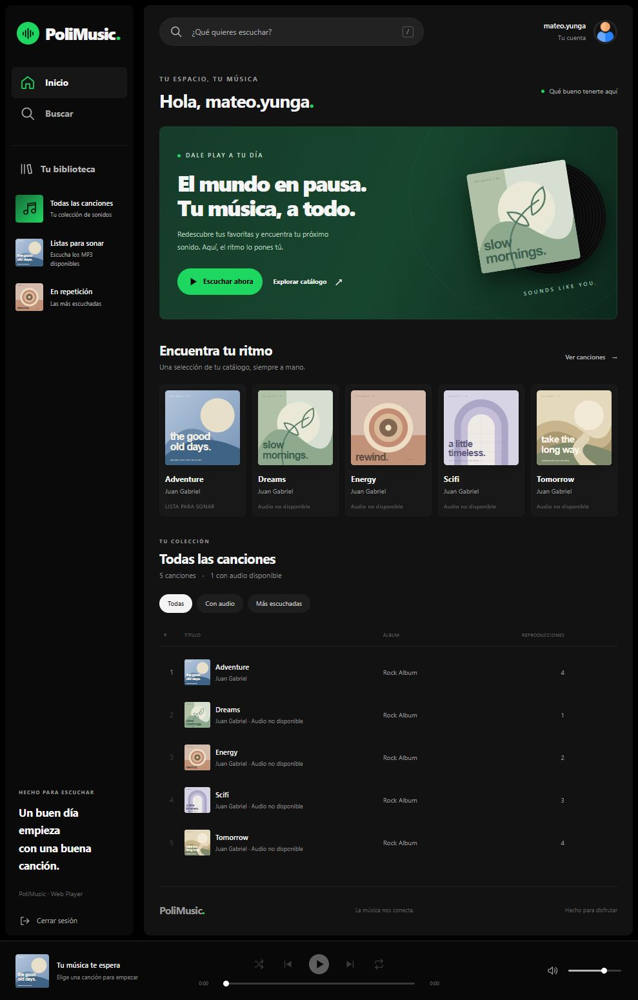

# PoliMusic V2 · ASP.NET Web Forms

Aplicación ASP.NET Web Forms con C#, .NET Framework 2.0, ADO.NET y SQL Server. Esta versión usa `.aspx` y clases `.cs`; la implementación ASP Clásico/VBScript permanece en `../webapppolimusicv1_asp`.

La interfaz está inspirada en Spotify: negro, gris carbón y verde `#1ED760`, menú lateral, portadas, catálogo sin tablas HTML y reproductor inferior. Login y registro comparten la misma paleta. La vista se adapta a escritorio y móvil, incluido el cierre de sesión.



[Ver captura móvil](../docs/screenshots/polimusic-v2-mobile.jpg).

## Ejecutar

1. Abre `../SlnAppPoliMusic.slnx` en Visual Studio con las herramientas de desarrollo web y las referencias de .NET Framework 2.0. Para ejecutar con CLR 2.0 en Windows, habilita .NET Framework 3.5, que incluye 2.0 y 3.0.
2. Copia `ConnectionStrings.example.config` como `ConnectionStrings.config` en esta carpeta y completa tus credenciales locales. `Web.config` carga ese archivo mediante `configSource`; el archivo real está ignorado por Git. Si ya existe, conserva su configuración. Inicia tu instancia SQL Server existente: la conexión `BDD_PoliMusicConnectionString` debe apuntar a `BDD_PoliMusic`, actualmente en el puerto `14333`. No ejecutes el SQL de referencia ni recrees el esquema.
3. Compila el proyecto y ejecútalo con IIS Express desde Visual Studio. Como alternativa, después de compilar, ejecuta desde la raíz del repositorio:

   ```powershell
   .\WebAppPoliMusicV2\tools\start-local.ps1
   # Puerto alternativo:
   .\WebAppPoliMusicV2\tools\start-local.ps1 -Port 61248
   ```

4. Abre [el login local](http://localhost:61247/Login.aspx). El script usa una configuración temporal de IIS Express y no modifica los sitios de Visual Studio ni del sistema. Pulsa Q para detenerlo.

Ambos roles entran en `Song.aspx`. Los usuarios normales consultan y reproducen; los administradores también ven **Añadir canción**, **Editar** y **Eliminar**. Se comprueba el rol nuevamente en el servidor.

## Archivos principales

- `Entities/Song.cs`: ID, nombre, ruta y reproducciones de una canción.
- `DAL/Song.cs`: consultas parametrizadas de lectura, creación, edición, eliminación y registro de reproducciones. La eliminación usa una transacción y retira primero los vínculos en `TBL_PLAYER`, `TBL_TRACKLIST` y `TBL_PLAYLIST_SONG`.
- `BLL/Song.cs`: validación de identificadores, nombres y rutas locales MP3; acceso a la capa DAL.
- `Song.aspx`, `Song.aspx.cs`, `Song.aspx.designer.cs`: interfaz Web Forms, sesión, permisos, formularios de gestión y subida de archivos.
- `Content/polimusic.css`, `Content/icons.svg`: estilos responsive e iconos locales.
- `Scripts/song.js`: búsqueda por título/artista/álbum, filtros de audio, orden por reproducciones y reproductor HTML5.
- `SongCovers/`: reutiliza las cinco portadas SVG disponibles en la versión ASP Clásico. Se conservan `PlaylistImages/`, `UserImages/` y `SongFiles/` del proyecto original.

## Canciones y reproducción

La interfaz muestra datos reales de `TBL_SONG`, con el primer artista y el primer álbum asociados, cuando existen. No agrega datos de demostración ni modifica el esquema. Editar una canción conserva sus reproducciones y relaciones. Eliminarla conserva los álbumes, artistas, playlists y archivos físicos.

El administrador puede elegir un MP3 de `SongFiles/` o subir uno nuevo de hasta 50 MB. Las subidas reciben nombres únicos y no sobrescriben archivos. La identidad de IIS necesita permiso de escritura en esa carpeta. El tamaño HTTP admite un MB adicional para los campos del formulario.

Solo se incluye `SongFiles/bensound-adventure.mp3`. Las canciones cuyo audio falta aparecen como **Audio no disponible**, con reproducción deshabilitada. Para habilitarlas, añade su MP3 correspondiente a `SongFiles/` o edita su archivo desde una cuenta administradora.

El reproductor incluye pausa, anterior/siguiente, avance, volumen, silencio, aleatorio y repetición. Buscar o filtrar conserva el audio y la cola actual. `/` enfoca la búsqueda y espacio alterna la reproducción cuando el foco está fuera de un control. Tras cinco segundos continuos de audio se registra una escucha; el servidor admite como máximo un incremento cada 30 segundos por sesión.

Los formularios usan ViewState ligado a la sesión, validación de eventos y token CSRF. Los títulos se codifican al escribir texto y atributos HTML. Al salir se eliminan la autenticación y la sesión.

## Verificación

Se verificaron la compilación del proyecto, la precompilación de páginas con ASP.NET 2.0 y 28 comprobaciones de integración HTTP/SQL, además de búsqueda, filtros, reproducción y diseño móvil en el navegador.

Para repetir las comprobaciones con IIS Express y SQL Server activos, usa **PowerShell 7** desde la raíz:

```powershell
.\WebAppPoliMusicV2\tools\verify-song.ps1
```

El script crea cuentas y canciones con identificadores aleatorios exclusivamente para las pruebas y las limpia en `finally`, junto con su audio temporal. Comprueba permisos, CSRF, validación, CRUD, subidas, contadores y conservación de relaciones y archivos. No cambia los datos existentes ni el esquema.
