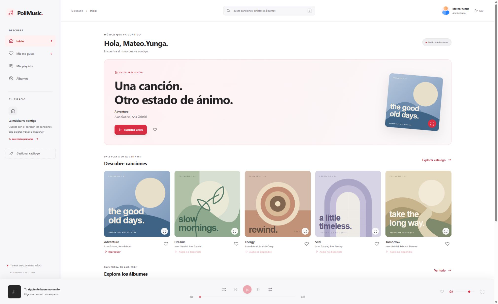

# PoliMusic · ASP Clásico

Aplicación de catálogo musical con HTML5, CSS Grid/Flexbox, JavaScript sin dependencias y backend exclusivamente ASP Clásico/VBScript con ADO. No requiere Node, compilación ni un framework de backend.

La interfaz usa fondos blancos, superficies gris claro y acentos rojos, definidos mediante variables en `style.css`, con el menú a la izquierda. El login ocupa todo el ancho de la pantalla; limita únicamente el ancho del contenido de cada panel y se apila en móvil. Las portadas de las canciones se conservan.



El [README del repositorio incluye el prompt original y los ajustes finales solicitados](../README.md#prompt-de-desarrollo).

## Ejecutar

1. Usa Windows con IIS y la característica **ASP** habilitada, o IIS Express con soporte para ASP Clásico. Configura el directorio `webapppolimusicv1_asp` como raíz de la aplicación. El Application Pool puede usar **No Managed Code**.
2. La instancia SQL Server existente debe estar accesible en `127.0.0.1:14333`, con la base `BDD_PoliMusic`. Si IIS está en otra máquina, ajusta el host. El puerto publicado por Docker es `14333`; la aplicación no inicia ni recrea el contenedor.
3. Copia `includes/config.example.asp` como `includes/config.asp` y completa las credenciales de tu SQL Server local, tomadas del script de referencia proporcionado. Si ya tienes `config.asp`, conserva tu configuración. La conexión utiliza el proveedor OLE DB `SQLOLEDB` de Windows y TCP. `config.asp` y `BDD_PoliMusic.sql` se excluyen de Git porque contienen credenciales; el script de referencia se conserva únicamente en el entorno local.
4. Abre `/login.asp`. El documento predeterminado es `index.asp` y redirige al login cuando no existe sesión.

Con IIS Express instalado en `C:\Program Files\IIS Express`, desde PowerShell en este directorio:

```powershell
.\tools\start-local.ps1
# Puerto alternativo:
.\tools\start-local.ps1 -Port 8092
```

El script usa una configuración temporal, un pool sin CLR y `http://localhost:8090/`. No modifica la configuración global de IIS. Para acceder en una red o publicar, configura el sitio y HTTPS en IIS; el script está pensado para uso local.

**No ejecutes `BDD_PoliMusic.sql` para iniciar la aplicación.** Es una referencia del modelo y contiene instrucciones para eliminar/recrear la base. La aplicación no ejecuta ese archivo ni contiene migraciones o cambios de esquema.

## Usuarios de referencia

Si la base conserva los datos iniciales del SQL:

- `userNormal`: rol `normal` (`USER_TYPE = 0`).
- `userAdmin`: rol `admin` (`USER_TYPE = 1`).
- `username1`: usuario normal con la contraseña SHA1 presente en el SQL.

Consulta las contraseñas en tu referencia SQL local; no se publican en el repositorio.

La autenticación comprueba los datos reales de `TBL_USER`; estos usuarios no están codificados como accesos alternativos. Para respetar el modelo proporcionado se admiten sus contraseñas existentes en texto y SHA1. No se altera su almacenamiento. Tras cinco credenciales fallidas se aplica una espera de un minuto en esa sesión.

## Archivos

- `login.asp`: autentica y define `Session("usuario")`, `Session("rol")`, ID del usuario y token CSRF.
- `logout.asp`: exige POST con token CSRF, abandona la sesión y vuelve al login.
- `index.asp`: valida la sesión y consulta canciones, artistas, álbumes, playlists propias y favoritos. Separa Inicio, Mis me gusta, Mis playlists, Álbumes y la gestión exclusiva del administrador. Muestra la bienvenida desde la sesión.
- `cancion.asp`: formulario de creación/edición exclusivo para administradores. Sugiere los MP3 disponibles en las carpetas locales.
- `procesar.asp`: valida nuevamente el rol y CSRF; ejecuta INSERT/UPDATE/DELETE parametrizados dentro de una transacción.
- `album.asp`: formulario exclusivo del administrador para nombre, año opcional, portada local y selección de canciones. Ofrece imágenes de `assets/PlaylistImages` y `assets/AlbumImages` cuando existe; conserva rutas antiguas con una portada de respaldo si falta el archivo. Permite álbumes vacíos.
- `procesar-album.asp`: CRUD de álbumes parametrizado y transaccional sobre `TBL_ALBUM` y `TBL_TRACKLIST`. Valida sesión, rol, POST, CSRF, identificadores, nombre, año y ruta de imagen. Conserva el formulario ante errores y revierte la operación si una canción seleccionada ya no existe.
- `album.js`: vista previa de portada, búsqueda de canciones y contador de selección del formulario de álbum.
- `reproduccion.asp`: registra una escucha tras cinco segundos continuos de reproducción. Ambos roles pueden registrar escuchas; este endpoint únicamente incrementa `PLAYS`. Limita el registro de la misma canción a uno cada 30 segundos por sesión.
- `includes/common.asp`: conexión, parámetros ADO, sesiones, autorización, validación y resolución de recursos, escape HTML e iconos.
- `includes/config.asp`: conexión local, constantes ADO y `ASSET_VERSION`, que permite actualizar la versión de CSS y JavaScript en todas las páginas desde un solo lugar.
- `includes/config.example.asp`: plantilla versionada sin credenciales reales para preparar la configuración local.
- `me-gusta.asp`: guarda o retira favoritos del usuario autenticado mediante POST parametrizado y CSRF. Usa una playlist privada reservada en las tablas existentes, con transacción y solicitudes idempotentes.
- `style.css` / `app.js`: interfaz responsive con menú izquierdo, navegación entre secciones y búsqueda. Un único audio alimenta la barra inferior y el reproductor ampliado, con pausa, avance, retroceso, progreso, volumen, aleatorio, repetición y pantalla completa cuando el navegador la permite. La cola se toma de la colección al comenzar a reproducir; navegar o buscar conserva la canción y esa cola. Atajos: `/` busca y espacio alterna pausa cuando el foco está fuera de los controles.
- `assets/`: archivos de imagen y audio. `PlaylistImages` contiene cinco imágenes y una portada genérica proporcionadas; `UserImages` contiene los avatares; `SongFiles` contiene el audio disponible. `SongCovers` conserva las cinco portadas SVG anteriores, restauradas exclusivamente para las canciones.
- `web.config`: establece el documento inicial y bloquea acceso HTTP al SQL, Markdown, `includes` y `tools`.

## Modelo y operaciones

Se usan exclusivamente tablas existentes: `TBL_USER`, `TBL_SONG`, `TBL_ALBUM`, `TBL_TRACKLIST`, `TBL_ARTIST`, `TBL_PLAYER`, `TBL_PLAYLIST` y `TBL_PLAYLIST_SONG`. No se crean tablas, columnas, procedimientos ni usuarios.

Mis me gusta utiliza la primera playlist del usuario con `TYPE = 1` y título reservado `Mis me gusta`, ordenada por ID. Solo se crea al guardar su primer favorito; abrir páginas y quitar un favorito inexistente no crean registros. Quitar el último favorito conserva su colección vacía. La galería de playlists excluye esa colección y muestra únicamente listas pertenecientes a la cuenta autenticada. El usuario del POST siempre se obtiene de la sesión. Un bloqueo transaccional en su fila serializa las solicitudes para evitar colecciones duplicadas, sin agregar restricciones al esquema. El título debe permanecer reservado si posteriormente se implementa edición de playlists.

Crear una canción inserta nombre/ruta y `PLAYS = 0`. Editar conserva reproducciones y asociaciones. Eliminar primero retira sus vínculos de `TBL_PLAYLIST_SONG`, `TBL_PLAYER` y `TBL_TRACKLIST` y después elimina `TBL_SONG`, todo en la misma transacción. No se eliminan álbumes, artistas, playlists ni archivos físicos. El formulario administra los campos de canción del esquema; las asociaciones existentes se consultan y se conservan al editar.

El administrador accede a **Gestionar catálogo → Álbumes** para crear, editar y eliminar álbumes. Guardar reemplaza únicamente las asociaciones de ese álbum en `TBL_TRACKLIST`; una canción puede pertenecer a varios álbumes. Eliminar retira sus asociaciones y después el álbum, sin eliminar canciones, escuchas, artistas, playlists ni archivos. El año vacío se guarda como NULL y, si la portada queda vacía o no existe, se usa una imagen de respaldo. No se suben archivos ni se crean carpetas para gestionar portadas.

Todas las entradas SQL del cliente usan parámetros ADO. Las acciones requieren POST, sesión y token CSRF; las de gestión comprueban además el rol en el servidor. Las salidas se codifican con `Server.HTMLEncode`. Los errores de conexión muestran mensajes públicos sin credenciales ni detalles SQL. Las páginas envían CSP y cabeceras para evitar caché y enmarcado.

## Audios y portadas

La copia inicial solo contiene `assets/SongFiles/bensound-adventure.mp3`. Los audios Dreams, Energy, Scifi y Tomorrow no están incluidos: se muestran como **Audio no disponible**, sin controles que apunten a archivos inexistentes.

Se conservan las rutas del SQL. Por ejemplo, `~/songFiles/bensound-adventure.mp3` se resuelve en `assets/SongFiles/bensound-adventure.mp3`. El mismo criterio adapta las rutas originales de álbumes, playlists, artistas y usuarios a sus subcarpetas correspondientes dentro de `assets/`. También se admiten rutas directas dentro de `assets/`. Las rutas deben ser locales; se rechazan URLs externas, navegación `..` y caracteres inválidos. IIS/Windows no distingue mayúsculas en estos nombres.

Puedes añadir los MP3 faltantes en `assets/SongFiles/` sin cambiar la base. Las rutas `~/albumImages/...` se buscan en `assets/AlbumImages/`. Como esa subcarpeta no está incluida, los álbumes utilizan las cinco imágenes proporcionadas en `assets/PlaylistImages/` como respaldo visual; no se consideran portadas originales del álbum. Las canciones usan las cinco portadas SVG anteriores de `assets/SongCovers/`, asignadas por su identificador, y el reproductor muestra la portada de la canción seleccionada. El reproductor sin selección y el icono del sitio usan la portada genérica existente.

El login usa `playlist3.png` como decoración y el editor usa `playlist2.png`; Inicio destaca la portada de una canción del catálogo. La foto del usuario se lee de `TBL_USER.USER_PHOTO` al autenticar y se guarda en la sesión: `root.png` corresponde al administrador del SQL de referencia y `default.jpg` sirve de respaldo cuando falta la foto. No se agregan columnas a ninguna tabla.

## Comprobación manual con la base disponible

1. Abrir `index.asp` sin sesión debe redirigir al login. Un login incorrecto debe rechazar el acceso.
2. Entrar como `userNormal`: verificar bienvenida, búsqueda, filtros por álbum y reproducción de Adventure. Confirmar que `cancion.asp` devuelve 403 y que no aparecen controles de gestión.
3. Entrar como `userAdmin`: crear una canción con el MP3 existente, editar su nombre y confirmar su eliminación. Comprobar los mensajes y la persistencia en SQL Server.
4. Cancelar una eliminación y verificar que no cambia el catálogo. Probar también una canción con asociaciones para comprobar que se retiran sus vínculos al eliminarla.
5. Una solicitud sin token CSRF no debe modificar datos. Cerrar sesión y comprobar que no se vuelve al catálogo con el botón Atrás.
6. Escuchar al menos cinco segundos y actualizar el catálogo para verificar el contador. Revisar la interfaz también en móvil.
7. Guardar una canción con el corazón, abrir Mis me gusta y recargar: debe conservarse. Entrar con otra cuenta y comprobar que su colección es independiente. Quitar el favorito debe retirarlo de esa vista.
8. Empezar a reproducir y navegar entre secciones: el audio debe continuar. Abrir el reproductor ampliado, comprobar los controles compartidos y probar pantalla completa y Escape donde estén disponibles.
9. Como admin, abrir Gestionar catálogo → Álbumes, crear uno, seleccionar sus canciones, editar su portada y selección y eliminarlo. Confirmar que sus canciones permanecen en el catálogo y que el usuario normal solo puede consultar los álbumes.

La ausencia de conexión SQL no se reemplaza por datos de demostración: la aplicación informa que el servicio no está disponible.

## Verificación

La gestión de álbumes superó 42 comprobaciones HTTP/SQL: permisos, sesión, POST y CSRF, validación, persistencia, campos opcionales, álbumes vacíos, selección de canciones y eliminación sin perderlas. Se comprobó que una canción inexistente revierte toda la operación y que una creación fallida no deja registros.

La revisión previa a la versión 1.0 superó 47 comprobaciones adicionales con IIS Express y SQL Server: autenticación de los tres usuarios de referencia, controles por rol, formularios, protección de archivos, rechazo de identificadores inexistentes, cierre de sesión y CRUD de una canción temporal con vínculos de álbum, artista y playlist. También se verificó el contador de escuchas y su límite por sesión. Se retiraron los datos temporales y se comprobaron los recuentos originales y el contenido de las canciones con sus escuchas. No se ejecutó el SQL de referencia ni se cambió el esquema.

En navegador se revisaron favoritos por usuario, búsqueda, playlists, selección de portada y canciones de álbumes, cancelación de eliminación, audio continuo entre secciones y reproductor ampliado. Se verificaron el menú izquierdo y la adaptación a escritorio y móvil, incluido el panel de álbumes a 320 px y su editor a 375 px.
